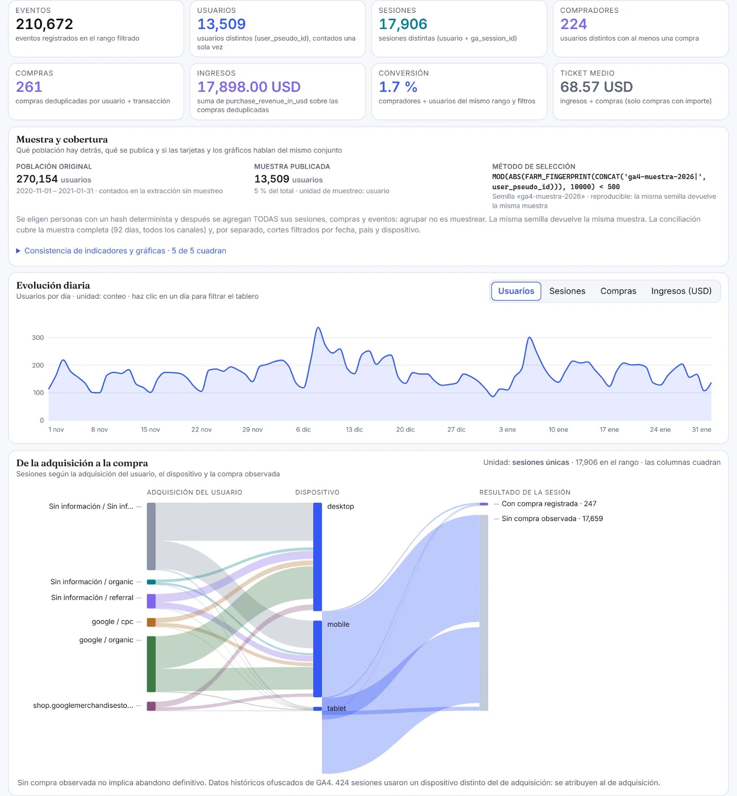

# Marketing y clientes · analítica GA4

Explora adquisición, conversión y retorno de usuarios a partir de eventos de
comercio electrónico: cohortes, embudo y afinidad por categoría sobre una muestra
pública y ofuscada de **Google Analytics 4**.

[](https://github.com/Dev-HugoAguilar/ga4-marketing-analytics/actions/workflows/tests.yml)
[](app)
[](#datos-y-atribución)

> **Alcance.** Los resultados describen **exclusivamente la muestra publicada** y
> no representan el desempeño comercial actual de Google ni se extrapolan a la
> población original.

---

## Ejecutar

Requiere la API del portafolio (`portfolio-api`) en el puerto 8010:

```bash
python -m uvicorn app.main:app --port 8010   # terminal 1

cd app && npm ci && npm run dev              # terminal 2
```

Producción: `npm run build`.



## Qué demuestra

- **Cohortes honestas**: los usuarios se cuentan de forma distinta dentro de cada
  selección; no se suman los conteos diarios.
- **Compras deduplicadas** por usuario y transacción antes de agregar.
- **Embudo con ventana declarada**: sesiones que completan los pasos en orden
  dentro de una ventana de 24 horas, y la ventana se declara en la interfaz.
- **Trazabilidad del origen**: cada cifra indica la muestra y el periodo del que
  procede.

## Datos y atribución

**Google Analytics 4**, muestra pública y ofuscada de comercio electrónico
(`bigquery-public-data.ga4_obfuscated_sample_ecommerce`, tablas `events_*`).
Periodo observado: **1 de noviembre de 2020 a 31 de enero de 2021**. El demo usa
una selección reproducible del **5 % de los usuarios: 13 509 personas** de una
población original de 270 154.

## Estructura

```text
app/                 Aplicación React + TypeScript (Vite)
  src/               Vistas de adquisición, cohortes, embudo y afinidad
  tools/             Minificador y utilidades de build
docs/LEEME.md        Documentación original del proyecto
docs/cover.jpg       Captura real de la aplicación
```

## Límites

- La muestra es histórica y del 5 % de usuarios: no se extrapola a la población.
- La fuente está ofuscada y puede contener valores de marcador o información
  desconocida.
- El canal describe la **adquisición** del usuario según su primera actividad
  observada: no es atribución por sesión ni evidencia del efecto causal de la
  publicidad.
- El embudo aplica una ventana analítica de 24 horas.
- Las compras por categoría pueden solaparse; la afinidad corresponde al periodo
  completo publicado.

## Seguridad y contribución

Sin credenciales ni datos personales en el repositorio. Ver [`SECURITY.md`](SECURITY.md)
y [`CONTRIBUTING.md`](CONTRIBUTING.md).
